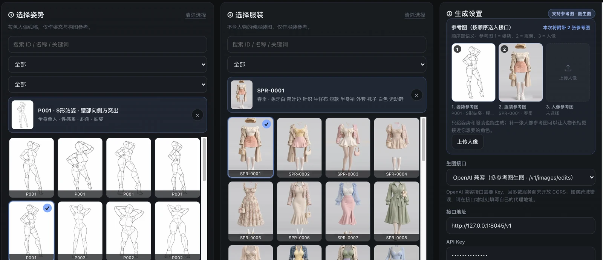
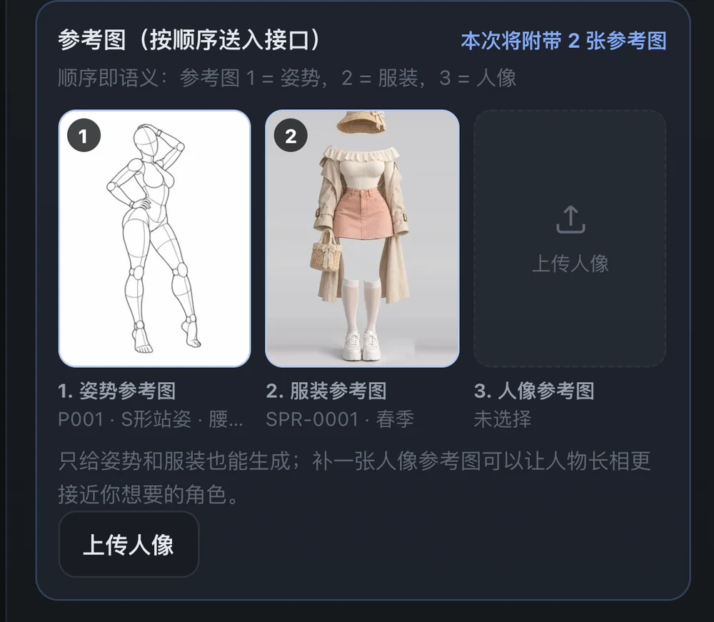
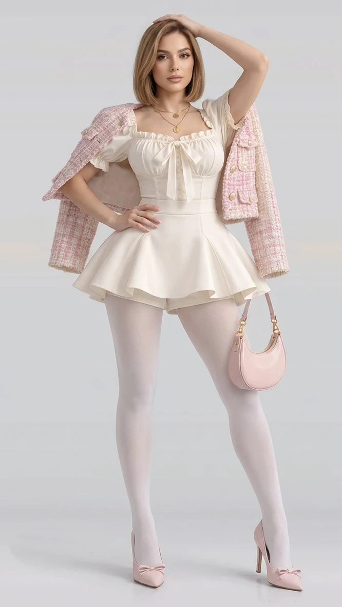

<div align="center">

# 姿势 × 服装 生成工作台
### POSE-DB-01 × COSTUME-DB-01 · Studio

**[English](README.en.md) · [日本語](README.ja.md)**

挑选姿势 · 挑选服装 · 配置生图 API · 一键生成并保存

</div>

---

## 这是什么

把两个日文 AI 绘画参考图库——**姿势集**和**服装集**——整合到一处，并做了一个**统一工作台**：
左边挑姿势、右边挑服装，再上传一张人像参考图，**三张图一起喂给生图接口做图生图**，
点一下就出成品，结果自动存进浏览器本地图库。

| | 内容 | 数量 |
|---|---|---|
| 🧍 **姿势库** POSE-DB-01 | 无面部灰色人偶**线稿**（3:4），每个姿势 5 个角度 | 288 组 / **1,439 张** |
| 🕳️ **深度库** POSE-DB-02 | 同一批姿势的**深度图**（3:4），与线稿逐张对应 | 288 组 / **1,439 张** |
| 👗 **服装库** COSTUME-DB-01 | 不含人物的纯服装图片（2:3），8 个分类 | **1,407 套** |
| 🎨 **统一工作台** | 姿势线稿 + 姿势深度 + 服装 + 人像 → 图生图 / 条件包导出 | 4 种接口 |

界面语言：**中文 / English / 日本語** 三语可切换。

---

## 三个库，一条条件管线

这三个库不是三本独立的相册，而是**同一条生成管线上的三种条件信号**：

| 角色 | 库 | 落到管线里的哪一步 |
|---|---|---|
| 姿势 | POSE-DB-01 线稿 | ControlNet **openpose** / lineart / scribble |
| 深度 | POSE-DB-02 深度图 | ControlNet **depth** |
| 服装 | COSTUME-DB-01 服装图 | IP-Adapter / T2I-Adapter 参考图 |
| 人像 | 本地上传 | IP-Adapter FaceID / InstantID / PuLID |

**关键事实：姿势库与深度库是同一批 288 组姿势 × 5 个角度的两种渲染。**
ID 集合、顺序、姿势编号、角度、分类、姿势名**逐条严格相同**——这是机器可验证的（见下文质检工具），
不是"看起来像"。所以在工作台里选一个姿势，**线稿与深度图会同时就位**，构成一对可直接喂给
openpose + depth 双 ControlNet 的条件图。

### 深度图的实测参数

| 项 | 实测值 |
|---|---|
| 格式 | 8-bit 灰度 PNG，900×1200 |
| 极性 | **近 = 白，远 = 黑** |
| 证据 | 躯干均值 138.3 > 顶部背景 59.8（60 张样本 97% 成立）；A/B 对照：线稿墨迹落在亮区 0.702 vs 暗区 0.292 |
| 结论 | 与 **MiDaS / ControlNet depth 惯例一致**，可直接当 depth 条件图用，**不需要反相** |
| 来源 | 3D 人偶渲染（不是从线稿估计），所以与线稿逐像素对齐 |

> 极性搞反是这类素材最常见的静默故障——图能生成，但空间关系全反。所以这项结论是**测出来的**，不是抄来的。

### 导出「条件包」

选好素材后点 **「导出条件包（ComfyUI / A1111）」**，直接得到一个 zip：

```
conditioning-pack.zip
├── pack.json              元数据：每个参考图的角色 / 来源库 / 原始 URL / 模型建议 / 种子
├── comfyui-workflow.json  ComfyUI API 格式工作流（openpose + depth 双 ControlNet 已连好）
├── a1111-prompt.txt       A1111 / Forge 可直接粘贴的提示词与参数
├── fetch-references.sh    把参考图抓到 ComfyUI 的 input 目录
└── README.txt             用法说明
```

工作流里已经串好 `LoadImage → ControlNetLoader → ControlNetApplyAdvanced`（线稿与深度各一路），
接上 `KSampler → VAEDecode → SaveImage`。服装与人像走 IP-Adapter，节点名随插件而变，
所以只给权重建议（SD1.5 / SDXL 各一套），不硬塞进图里。

> ⚠️ **这份 ComfyUI 工作流是模板，从未在真实 ComfyUI 实例上跑通验证。**
> 它按 ComfyUI 官方 API 格式生成，但 `ckpt_name` 是占位符、ControlNet 权重名按 SD 1.5 给、
> IP-Adapter 节点因插件而异未写入。**请自行测试后再投入正式出图**——
> 导出的 `README.txt` 里附了逐条自测清单（参考图是否抓到 → 工作流能否无红节点载入 →
> 只开 openpose 骨架是否对 → 再开 depth 遮挡是否反转 → 服装/人像是否接近参考）。
> 素材本身是验证过的（配对、极性、离群，见下），但**管线这一段没有**。

### 质检：除了你我，还有什么能证明结果是对的

`tools/verify_library.py` 把上面所有结论变成**可复现、可进 CI 的断言**：

```bash
python3 tools/verify_library.py            # 离线：清单 / 配对 / 极性 / 离群 / 页面
python3 tools/verify_library.py --sample 200 --online   # 加像素抽样 + sha256 对原站抽检
```

当前结论：**15 项全部通过，0 失败**（含 ID 集合一致、顺序一致、元数据逐条一致、
每条姿势都挂上深度通道、极性 A/B 判别、四个系列主体面积无 3σ 离群、三个页面无残留链接）。

---

## 演示



*工作台三栏：**① 选择姿势** → **② 选择服装** → **③ 参考图与接口设置***

<table>
  <tr>
    <td width="56%" valign="top"></td>
    <td width="20%" valign="top"></td>
    <td width="24%" valign="top">
      <b>参考图区</b><br>
      顺序即语义：<b>1 = 姿势</b>、<b>2 = 服装</b>、<b>3 = 人像</b>，三张一起发给接口。<br><br>
      <b>生成结果</b><br>
      姿态来自参考图 1，服装来自参考图 2。
    </td>
  </tr>
</table>

---

## 快速开始

### 在线预览

仓库根目录的 `index.html` 就是工作台，`galleries/` 下是两个独立图库。

```bash
git clone https://github.com/XuXuebin/ai-pose-costume-gallery.git
cd ai-pose-costume-gallery
python3 -m http.server 8899
# 打开 http://127.0.0.1:8899/
```

> ⚠️ 请用 **`127.0.0.1`** 而不是 `localhost` 打开：Pollinations 会拒绝 `localhost` 来源的请求（返回 403）。
> 两个图库页面本身用 `file://` 双击打开也能正常看图。

> 📌 **图片不存进仓库**：所有图片都直接从原站地址加载（姿势库取自 `ai-pose-gallery.pages.dev`，
> 服装库取自 `ai-costume-gallery.pages.dev`）。因此整个仓库只有约 **2.5 MB**，
> GitHub Pages 部署几乎瞬间完成；代价是需要能访问这两个原站。

### 部署到 GitHub Pages

仓库已内置 `.github/workflows/pages.yml`，推送后自动部署：

```bash
git init && git add . && git commit -m "feat: 姿势×服装统一工作台"
git branch -M main
git remote add origin git@github.com:XuXuebin/ai-pose-costume-gallery.git
git push -u origin main
```

然后在仓库 **Settings → Pages → Source** 选择 **GitHub Actions**。

> 🟢 **本仓库已上线**（GitHub Actions 自动部署）：
> **工作台** https://xuxuebin.github.io/ai-pose-costume-gallery/
> **姿势库** https://xuxuebin.github.io/ai-pose-costume-gallery/galleries/pose/
> **服装库** https://xuxuebin.github.io/ai-pose-costume-gallery/galleries/costume/

也可用 Cloudflare Pages / 对象存储 / Nginx：`site` 不需要构建命令，仓库根目录就是发布目录。

---

## 统一工作台怎么用

```
① 选择姿势  →  ② 选择服装  →  ③ 参考图 + 接口设置  →  生成  →  自动进图库
```

1. **选姿势**：按系列（4 个）、角度（5 个）、分类筛选，或搜索 ID / 姿势名。
   选中的那张人偶线稿会**自动成为参考图 1**。
2. **选服装**：按分类（8 个）筛选，或搜索 ID / 关键词（中文英文都能搜）。
   选中的那张服装图会**自动成为参考图 2**。
3. **上传人像参考图**：把想要的人物长相的图片拖进第三个槽位（可留空）→ **参考图 3**。
4. **配接口**：四种生图 API 任选，填好即用。
5. **点「生成图片」**：结果直接显示，可下载 PNG；**同时自动存入本地图库**（IndexedDB），刷新页面也不会丢。
6. **图库**：可复用提示词、下载、删除、清空。图片只存在你自己的浏览器里，**不会上传**。

### 参考图怎么送进接口

三张参考图**按槽位顺序**送入接口，提示词里用「Reference image 1/2/3」指代它们：

| 槽位 | 来源 | 送给接口的原始文件 | 作用 |
|---|---|---|---|
| 1 姿势参考图 | 姿势库 | `原图`（900×1200 PNG） | 姿态、肢体、构图 |
| 2 服装参考图 | 服装库 | `图像`（1366×2048 WebP） | 服装、配色、材质 |
| 3 人像参考图 | 本地上传 | 原文件 | 人物长相、发型 |

原站两个图库都带 `Access-Control-Allow-Origin: *`，所以浏览器能**跨域取到图片字节**
并转成接口需要的格式（multipart 文件 / base64），不需要把图片塞进仓库。

### 本机 Antigravity 代理（推荐）

如果你本机跑着 Antigravity 的 OpenAI 兼容代理（默认 `http://127.0.0.1:8045/v1`），
点「快捷预设 → **本机 Antigravity 代理**」即可一键填好：

```
接口地址   http://127.0.0.1:8045/v1
API Key    sk-antigravity
模型       gemini-3.1-flash-image
画质       hd
```

- **读取模型列表**按钮会调 `GET /v1/models` 把代理里可用的模型（实测 23 个）填进下拉建议。
- **尺寸**支持任意 `WIDTHxHEIGHT`（代理会自动算宽高比），旁边有 1:1 / 2:3 / 3:4 / 16:9 快捷键。
- 参考图会在浏览器里等比压到最长边 896px 并转 JPEG（线稿 400KB → 61KB），上传快很多。

> ⚠️ **两点实测提醒**
> 1. 线上 Pages 是 **https**，浏览器会对 `http://127.0.0.1` 启用 **Private Network Access** 拦截。
>    要用本机代理请从**本地预览**打开：`python3 -m http.server 8899` → `http://127.0.0.1:8899/`。
>    界面检测到本机地址时会提示这一点。
> 2. 该代理的账号池里有**被地区限制**的账号，会随机返回 `User location is not supported for the API use.`；
>    **3 张参考图**时还可能长时间挂起。实测 **2 张（姿势 + 服装）最稳**，出图约 60–90 秒。
>    界面已加 180 秒超时与耗时提示，失败后可直接「换一张」重试。

### 四种生图接口

| 接口 | 密钥 | 多参考图 | 说明 |
|---|---|---|---|
| **Pollinations** | 免密钥 | ✗ | 仅文生图。浏览器直连即可用，生成内容由第三方服务提供 |
| **OpenAI 兼容** | 需要 | ✓ | `POST /v1/images/edits`，三张图作为 `image[]` 一次性提交；多数服务商不开 CORS，跨域报错时请在「接口地址」填自己的代理 |
| **Google Gemini** | 需要 | ✓ | `generateContent`，三张图作为 `inline_data` base64 提交，可一次多图 |
| **自定义地址** | 视情况 | ✓ | `POST` JSON：`{prompt, images:[{role,name,data_url}], width, height, seed, model}` |

选了不支持参考图的接口时，界面会**明确警告**「只会按提示词文字生成」。

接口地址、密钥、模型、种子会保存在浏览器 `localStorage`，**不上传服务器**。
公用设备请用完清掉（浏览器清除站点数据即可）。

### 提示词是自动拼的

选中参考图后，提示词会自动组合成模型看得懂的英文描述：

```
Outfit details: cream blouse ribbon ivory mini skirt shorts jacket beige tights.
Reference image 1 is the POSE and body posture to reproduce exactly.
Reference image 2 is the OUTFIT to put on the character, keep the same clothing, colors and materials.
Reference image 3 is the CHARACTER: keep the same face, hairstyle and overall appearance.
Generate a full-body character illustration that keeps the pose from the pose reference,
the outfit from the costume reference, the face of the person reference.
Single character, clean plain background, studio lighting, high quality, detailed fabric texture, natural proportions.
```

姿势的中文术语（分类 / 角度 / 系列）都有一份英译对照表（`tools/pose_terms.json`），
改词表后重新同步即可。提示词可以随意编辑，默认负面提示词含 `nudity, explicit, nsfw` 等。

---

## 目录结构

```
ai-pose-costume-gallery/
├── index.html              ★ 统一工作台（GitHub Pages 首页）
├── studio/
│   ├── studio.css          工作台样式
│   ├── i18n.js             中 / 英 / 日 三语文案
│   ├── generator.js        生图 API 适配层（Pollinations / OpenAI / Gemini / 自定义）
│   ├── pipeline.js         条件包构建（ComfyUI 工作流 + A1111 提示词 + 元数据）
│   ├── zip.js              零依赖 ZIP 打包器
│   └── studio.js           选图、通道切换、生成、导出、图库逻辑
├── galleries/
│   ├── pose/index.html     姿势库（线稿，含 A4 打印排版）
│   ├── depth/index.html    深度库（深度图）
│   └── costume/index.html  服装库
│                            ↑ 图片路径全部指向原站，仓库内不放图片
├── data/
│   ├── manifest.json       三库清单：来源 / 许可 / 计数 / 深度技术参数 / 配对关系
│   ├── pose.json           姿势数据（已配对深度双通道）
│   ├── pose-depth.json     深度数据
│   └── costume.json        服装数据
├── docs/                   演示图片（README 用）
│   ├── demo-studio.webp    工作台三栏全景
│   ├── demo-refs.webp      参考图区特写
│   └── demo-result.webp    生成结果示例
├── tools/
│   ├── sync.py             从三个源项目同步 → 生成 galleries/ 与 data/
│   ├── pose_terms.json     姿势术语英译表
│   ├── fetch_originals.py  按需下载原尺寸 PNG（离线用）
│   ├── verify_library.py   ★ 三库一致性质检（配对 / 极性 / 离群 / sha256）
│   └── verify.py           数据与路径完整性校验
├── .github/workflows/pages.yml   GitHub Pages 自动部署
├── NOTICE.md               素材版权与原始来源
├── LICENSE                 代码 MIT
└── README.md / README.en.md / README.ja.md
```

### 重新同步素材

本仓库的 `galleries/` 与 `data/` 是**从两个源项目生成的**：

```bash
python3 tools/sync.py                # 同步（需要 ../ai-pose-gallery 与 ../ai-costume-gallery）
python3 tools/sync.py --local-assets # 顺便把图片复制进仓库（约 237 MB，自包含离线版）
python3 tools/verify.py              # 校验数据条数 / 字段 / 路径引用 / 三语 README
```

默认不同步图片（页面与数据里写原站绝对地址）。
想做成**完全自包含、不依赖原站**的版本时，加 `--local-assets`：
姿势原图会在本地转成 WebP（900×1200），下载按钮仍指向原站原尺寸 PNG。

---

## 与原站的差异

**只有一点：图片不存进仓库，改为直接引用原站地址。**

原站图片合计约 2.1 GB，全量入库会让 GitHub 仓库与 Pages 部署非常笨重；
改成引用原站后，仓库只有约 2.5 MB，克隆与部署都是秒级。
代价是：原站不可达时图片就加载不出来。

需要离线或自包含时，用 `python3 tools/sync.py --local-assets` 生成带本地素材的版本，
或用 `python3 tools/fetch_originals.py` 按需拉取原尺寸 PNG。

功能上，除新增统一工作台外，两个图库的浏览、筛选、检索、放大、**A4 打印排版**与
「下载原尺寸 PNG」都与原站一致。

---

## 致谢与来源

**原始作者：ギア（@giaaibusi）** — https://x.com/giaaibusi

| 原站 | 链接 |
|---|---|
| 姿势集 POSE-DB-01 | https://ai-pose-gallery.pages.dev/ |
| 服装集 COSTUME-DB-01 | https://ai-costume-gallery.pages.dev/ |

本仓库为**非官方的中文本地化 / 整合版本**，与原作者无隶属关系。
图片版权归原作者所有，遵循原站条款：**免费用于作品创作（含商用）且无需署名**，
但**禁止对图片数据本身进行再分发、转载或转售**；画面为 AI 生成的虚构内容
（灰色人偶线稿 / 纯服装图），**请勿用于表现真人或未成年人**。
完整条款见 [NOTICE.md](NOTICE.md)。

---

## 许可

- **代码**（工作台、脚本、样式、文档）：[MIT](LICENSE)
- **图片素材**：版权归原作者 ギア 所有，遵循原站条款
